<div align="center">

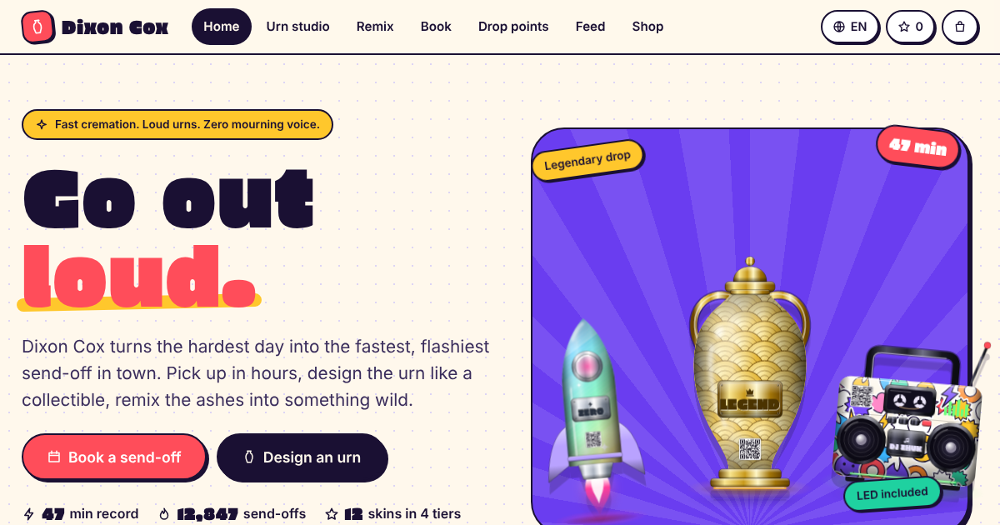

# DIXON COX
### The fastest, loudest, best-looking cremation service ever shipped as a web app.

**Zero dependencies. Zero payments. Zero mourning voice. Infinite style.**

[Live demo](#-put-it-online-in-60-seconds) · [Why I am the best](#-why-this-is-the-best-repo-you-will-open-today) · [Screenshots](#-look-at-it-go-on) · [Run it](#-run-it)

</div>

---

> You are looking at the finest piece of funeral-adjacent software in existence.
> I did not say "one of". I said **the**. Read on and try to prove me wrong. You will fail, and you will have fun failing.

## 🔥 Why this is the best repo you will open today

Other projects "have a roadmap". Dixon Cox has a **drop point with self-unlocking cells**, a **gacha for urns**, and a **47-minute world record** on the leaderboard. (The record is fictional. My confidence is not.)

| Brag | Receipts |
|---|---|
| **Dependencies** | `0`. No `node_modules`. No lockfile. No supply chain. The build script is one file you can read over a coffee. |
| **Urns** | 6 shapes × 12 skins × 4 rarity tiers × 5 typefaces × 11 engraving symbols × 7 LED colours. All drawn in pure SVG by code, with metallic gradients, cylinder shading and real engraving emboss. No stock art. No ASCII. No acid colours. |
| **QR memorial codes** | A hand-written QR encoder (versions 1 to 12, ECC level M). Verified decodable with OpenCV. Yes, I wrote a QR encoder instead of installing one. |
| **Languages** | English and Ukrainian, 539 strings each, enforced by a test that fails the build if a single one goes missing. |
| **Tests** | 37 and green, covering pricing, urn rendering, QR structure, the router, the mock backend and i18n parity. |
| **Bundle** | ~244 KB of JS, ~1.1 MB for the entire app (fonts included) as a **single HTML file** you can email to your grandmother. |
| **Accessibility** | Keyboard reachable, visible focus, ARIA states on every toggle, `prefers-reduced-motion` respected, light and dark schemes, colour-blind-checked chart palette. |
| **Architecture** | A custom view layer (escaped templates + DOM morphing that keeps focus), a hash router, an observable store and a swappable async backend. I built a tiny framework in the gaps between features. |

## ✨ What it does

**Book a send-off in 7 steps.** Legend and tribute writer → urn → ash remix → ceremony (livestream, playlist, partners, fireworks time) → pick-up → e-signature → ticket. Or flip to **pre-plan mode** and keep everything on file for later.

**Two ways to get the urn back.**
- **Courier**: choose a discreet van or a flashy hearse-bike, then watch it cross the city map live.
- **Drop-point cells**: the one from the anime. Pick a pin, pick a free cell, get a 6-digit code, walk up, punch it in, and the door swings open to reveal the legend. Four locker banks across a fictional city.

**The Urn Studio.** Shape, skin, engraving (metal plaque or etched), LED base, QR code, speaker chip, your own artwork. Roll the dice for a rarity-weighted gacha drop, save to your garage, share a link that contains the whole design, export PNG or SVG with the fonts baked in.

**Ten ash remixes.** Vinyl record, keychain, figurine, memorial diamond, tattoo ink, fireworks launch, glass orb, reef ball or tree pod, space send-off, vial pendant. Each with variants and its own price.

**Everything else a legend deserves.**
Live feed of the latest send-offs and the designs people used · stats with area chart, skin leaderboard, donut, busiest-hours heatmap and turnaround histogram · memorial walls with candles, comments and playlists · family voting links · legacy points and tiers · gift codes (try `LOUD10`, `LEGEND25`, `GOODBOY`) · payment-plan display · merch shop · pet line · referral codes.

> **No money moves. Ever.** Checkout is a decorative `disabled` button, payment plans are display-only, and every person and pet in the feed is invented. Nobody is cremated by this repository.

## 📸 Look at it. Go on.

<table>
<tr>
<td width="50%">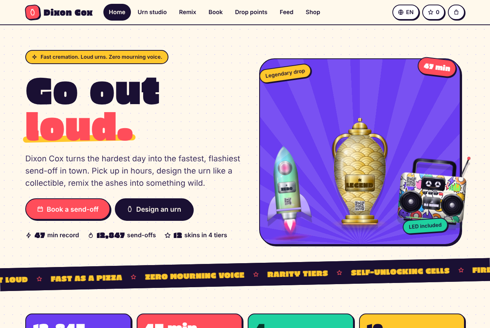<br><sub><b>Home.</b> The hero urns react to clicks. Confetti is not optional.</sub></td>
<td width="50%">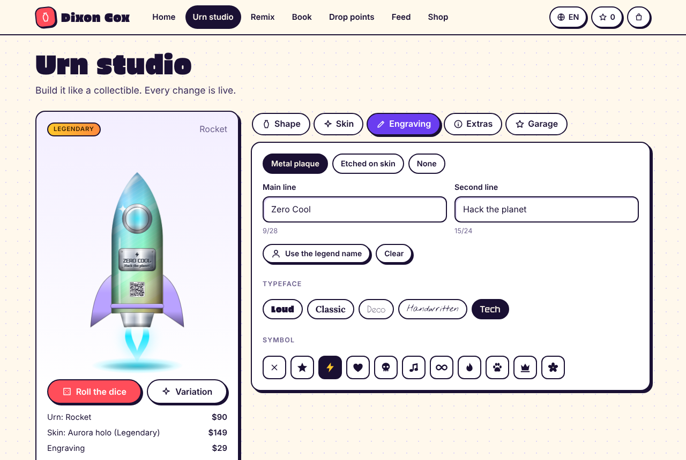<br><sub><b>Urn Studio.</b> A Legendary rocket urn, engraved, LED glowing.</sub></td>
</tr>
<tr>
<td>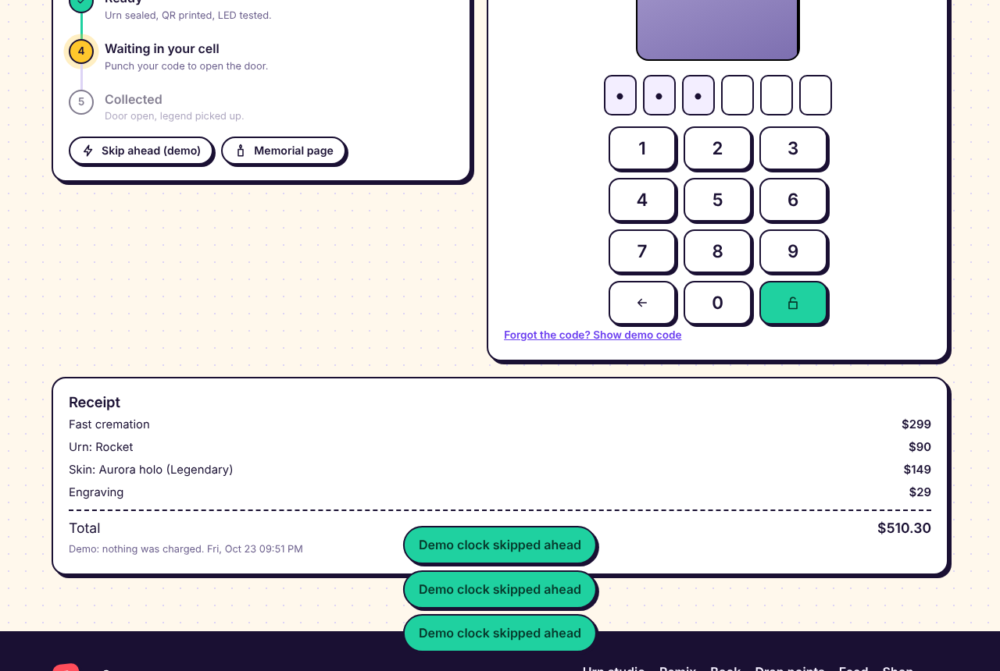<br><sub><b>The keypad.</b> Your 6-digit code. Tap it in.</sub></td>
<td>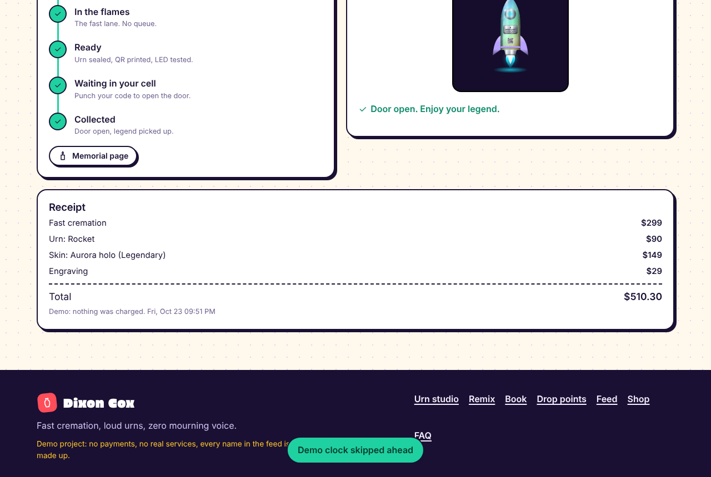<br><sub><b>Door open.</b> Legend collected.</sub></td>
</tr>
<tr>
<td>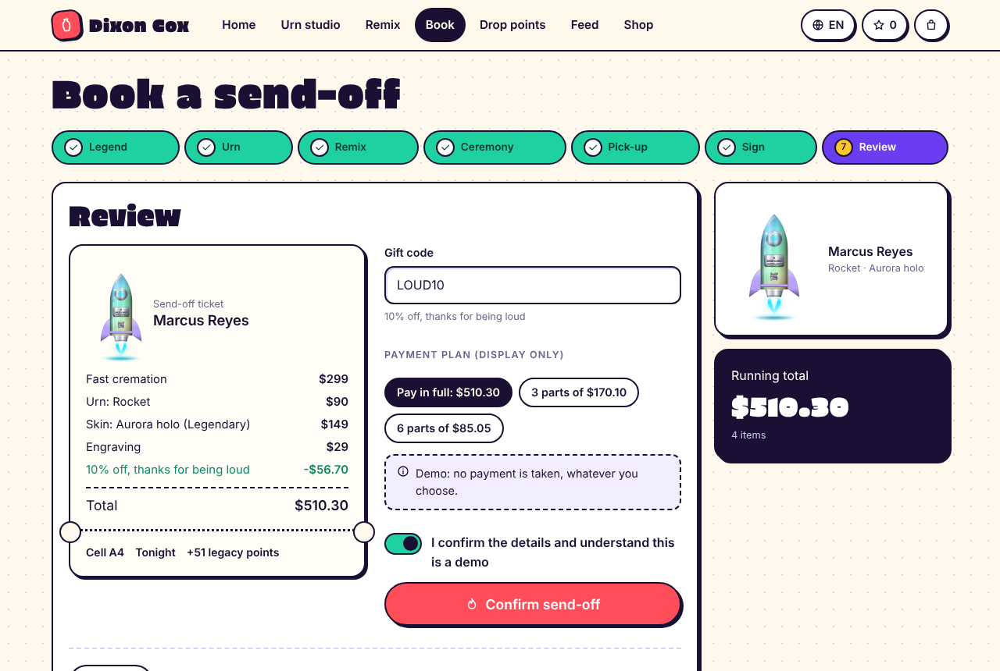<br><sub><b>The ticket.</b> Itemised, discounted, gloriously fake-payable.</sub></td>
<td>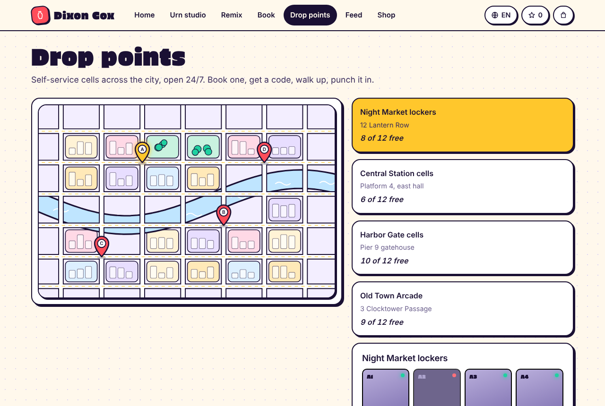<br><sub><b>Drop points.</b> Four banks of cells across the city.</sub></td>
</tr>
<tr>
<td>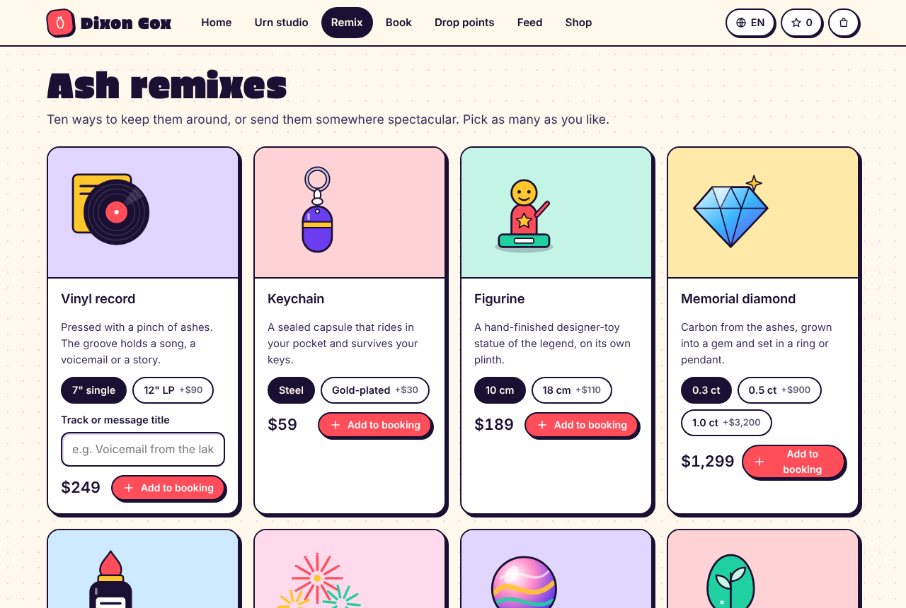<br><sub><b>Remixes.</b> Ten ways to go out loud.</sub></td>
<td align="center">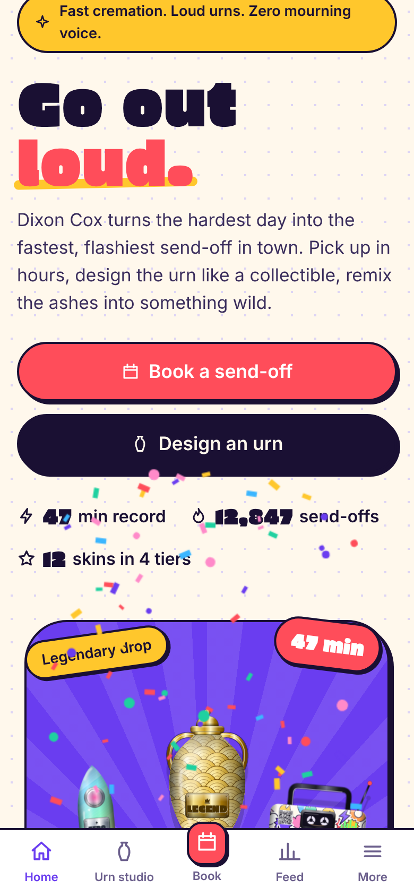 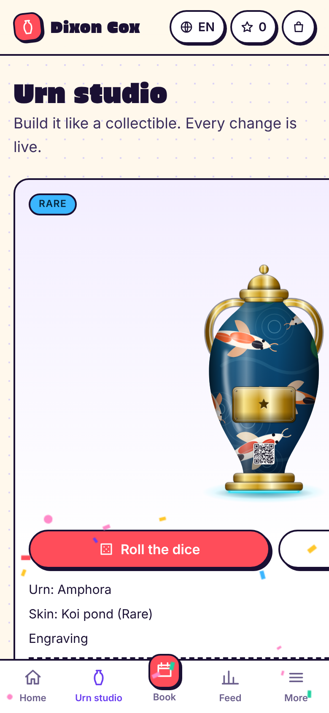<br><sub><b>Mobile-first.</b> Tab bar, bottom sheet, thumb-sized everything.</sub></td>
</tr>
</table>

Every skin, in case you need to be convinced:

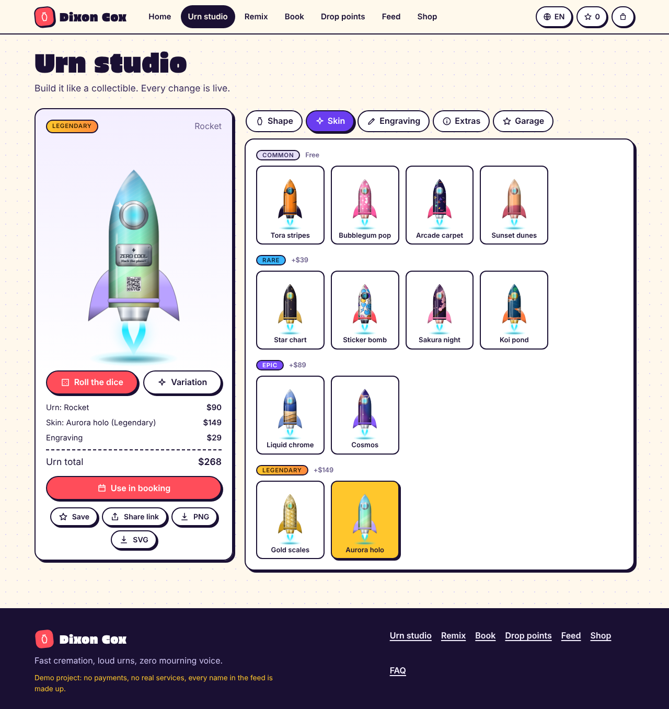

Stats and the live feed: [`docs/screenshots/feed.png`](docs/screenshots/feed.png).

## 🚀 Put it online in 60 seconds

You have two options. Both are free. Both are correct. Pick the one that makes you feel smartest.

**Option A: the repo as-is (no build).**
The source is native ES modules, so GitHub can serve it directly.
1. Push this repo to GitHub.
2. *Settings → Pages → Build and deployment → Deploy from a branch → `main` / `/ (root)`.*
3. Done. Your demo lives at `https://<you>.github.io/<repo>/`.

**Option B: the Actions pipeline (tests, then build, then deploy).**
1. Push to `main`.
2. *Settings → Pages → Source: **GitHub Actions**.*
3. `.github/workflows/pages.yml` runs the tests, the i18n check and the build, then deploys `dist/`.

**Option C: one file.** Run `npm run build` and take `dist/dixon-cox-demo.html`. It is the entire app: JS, CSS and fonts inlined. Open it by double-click, host it anywhere, attach it to an email.

## 🛠 Run it

You need Node 20+. You do not need `npm install`. There is nothing to install.

```bash
node scripts/serve.mjs      # dev server on http://localhost:5173 (or: npm start)
npm test                    # 37 tests, node:test, no framework
npm run check:i18n          # every t('...') must exist in the Ukrainian dictionary
npm run build               # dist/ site + dist/dixon-cox-demo.html
```

## 🧠 How it is built

```
index.html
src/
  main.js            boot: store, i18n, router, shell
  pages/             12 page modules: (ctx) => { render, handlers, after?, destroy? }
  ui/                shell, components, cards, icons, fx (confetti, toast, tooltip), PNG/SVG exporter
  art/               urn renderer (shapes, skins, engraving), city map, charts, remix + merch art
  api/               mockApi.js (async, persisted in localStorage, simulated latency) + seed data
  lib/               view layer, router, store, i18n, pricing, QR encoder, tribute writer, share links
  data/catalog.js    everything you can buy, every drop point, every FAQ
  locales/uk.js      Ukrainian
scripts/             serve, build (mini bundler), check-i18n
tests/               node:test suites
```

- **View layer** (`src/lib/view.js`): auto-escaping `html` tagged templates, a DOM morpher that keeps focus, scroll and half-typed input alive between renders, and delegated events via `data-on-click="handlerName"`. About 100 lines.
- **Urn engine** (`src/art/urn.js`): a pure function, `design → SVG string`. Same input, same urn, byte for byte. Runs in Node, which is how the tests render all 72 shape and skin combinations.
- **Backend seam** (`src/api/mockApi.js`): every call the UI makes is an `async` function there. To go real, re-implement that one file against a server. The demo clock runs fast on purpose: an order finishes in about two and a half minutes so you can watch the whole timeline.
- **i18n**: gettext style. The English string is the key, `t('Book now')`. Data files mark strings with `_()` so the checker can find them.
- **No cycles, no default exports, no dynamic imports.** That is the contract that lets a 120-line build script bundle everything correctly.

## 📜 Honest print

- **Demo.** No payments, no real services, no cremations. All names, tributes, counts and the 12,847 "send-offs" are made up.
- **Data stays in your browser** (`localStorage`). *Me → Reset demo* wipes it.
- **Fan homage.** The idea is inspired by a scene in the animated series *Cyberpunk: Edgerunners*. This project is not affiliated with, endorsed by, or connected to any studio or rights holder, and it uses no characters, names, logos or art from the series. The city is fictional, the brand is its own.
- **Fonts** (Erica One, Lora, Poiret One, Nothing You Could Do, Tektur, Inter) are self-hosted under the SIL Open Font License. Licenses are in `fonts/licenses/`.
- **License:** MIT. Fork it. Rename it. Put your own name on it. Just know that it will never be as good as the original.

<div align="center">

**Dixon Cox. Go out loud.**

</div>
